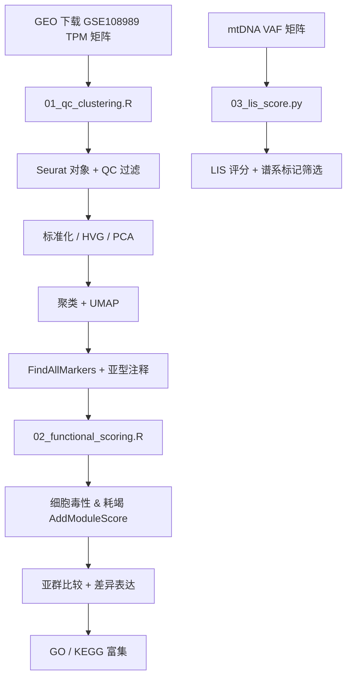

# scrna-crc-tcells：结直肠癌浸润 T 细胞单细胞转录组分析

> 毕设项目（转录组部分） · 简历主项目

## 一、项目简介与科学问题

本项目基于公开数据集 **GSE108989**（Zhang et al., *Nature* 2018，结直肠癌 T 细胞 Smart-seq2 单细胞转录组），研究的科学问题是：

> **结直肠癌浸润 T 细胞中，克隆扩增的 T 细胞能否被线粒体 DNA（mtDNA）突变可靠标记？其转录状态（细胞毒性 / 耗竭）有何特征？**

本仓库为毕设前段（转录组部分）：完成 T 细胞亚群鉴定、功能状态定量与功能富集分析；mtDNA 部分提供 LIS 谱系标记评分工具（`03_lis_score.py`），用于连接后续变异分析。

## 二、数据集说明

| 项目 | 内容 |
|---|---|
| GEO 编号 | GSE108989 |
| 文献 | Zhang et al., *Nature* 2018, "Lineage tracking reveals dynamic relationships of T cells in colorectal cancer" |
| 样本 | 12 例结直肠癌患者，肿瘤 / 癌旁 / 外周血 |
| 细胞数 | 约 11,000 个 T 细胞 |
| 平台 | **Smart-seq2**（全长转录本，单细胞分选板测序；非 10x） |
| 表达量 | TPM 矩阵（GEO Supplementary file 提供下载） |

**体积与内存预估（硬盘紧张请注意）**：

- TPM 矩阵压缩包约 **200–500 MB**，解压后文本约 **1–2 GB**
- 读入 R 后占用内存约 1–2 GB；Seurat 全流程峰值约 **4 GB**
- 建议：内存 ≥ 8 GB，预留 ≥ 5 GB 空闲硬盘；跑完可删除解压后的 txt（保留 .gz 即可）

## 三、分析流程



## 四、环境安装

### 软件

1. **R ≥ 4.2**（https://cran.r-project.org/bin/windows/）+ **RStudio**（可选）
2. **Python ≥ 3.8**（仅用于 `03_lis_score.py`）
3. Windows 编译 R 包可能需要 **Rtools**（https://cran.r-project.org/bin/windows/Rtools/）

### R 包（在 R 控制台执行）

```r
install.packages(c("Seurat", "dplyr", "ggplot2", "patchwork",
                   "data.table", "plyr", "tidyr", "GEOquery"))

# clusterProfiler 系列需用 BiocManager 安装
install.packages("BiocManager")
BiocManager::install(c("clusterProfiler", "org.Hs.eg.db"))
```

### Python 包

```bash
pip install pandas numpy
```

## 五、运行顺序

| 步骤 | 命令 | 必需性 | 预期输出 |
|---|---|---|---|
| 1 | 下载 GSE108989 TPM 矩阵放入 `data/`（方式见 01 脚本开头注释） | 【必须】 | `data/GSE108989_TPM.txt` |
| 2 | `Rscript 01_qc_clustering.R` | 【必须跑通】 | QC 小提琴图、Elbow 图、UMAP（聚类/注释）、marker 热图、`cluster_markers.csv`、`seu_annotated.rds` |
| 3 | `Rscript 02_functional_scoring.R` | 【必须跑通】 | 评分 UMAP、亚群箱线图、统计检验 txt、差异表达 csv + 火山图、GO/KEGG 气泡图 |
| 4 | `python 03_lis_score.py --demo` | 【可选】（自测） | `demo_vaf_matrix.csv`、`demo_vaf_matrix_lis.csv`，自测通过提示 |
| 5 | `python 03_lis_score.py <你的VAF矩阵.csv>` | 【可选】（mtDNA 阶段） | `*_lis.csv`，含 LIS 评分与谱系标记列 |

> 注：步骤 3 中的自动亚型注释是规则法初稿，**务必对照 FeaturePlot 与 marker 表人工核对**后再用于结论。

## 六、常见问题 FAQ

**Q1：`could not find function "CreateSeuratObject"` 或 Seurat 装不上？**
A：先确认 R 版本 ≥ 4.2；Windows 下编译失败通常是缺 Rtools，安装与 R 版本对应的 Rtools 后重试；也可 `install.packages("Seurat", dependencies = TRUE)`。

**Q2：`cannot allocate vector of size X Gb`（内存不足）？**
A：关闭其他程序释放内存；或在读入后只保留表达 > 0 的细胞列；实在不行用 `seu <- subset(seu, downsample = ...)` 抽样部分细胞跑通流程。8 GB 内存电脑建议分批运行。

**Q3：`fread` 报错 "文件不存在" / 路径错误？**
A：Windows 路径在 R 里要用正斜杠 `data/GSE108989_TPM.txt` 或双反斜杠；确认解压后的真实文件名与 `expr_path` 一致（GEO 文件名常含样本描述，不是这个名字）。

**Q4：`BiocManager::install` 卡住或超时？**
A：切换国内镜像：`options(BioC_mirror="https://mirrors.tuna.tsinghua.edu.cn/bioconductor")`，再重新安装。

**Q5：`FeaturePlot` 报 "gene not found"？**
A：TPM 矩阵的基因名可能是 Ensembl ID 而非基因符号，检查 `rownames(seu)[1:5]`；若是 Ensembl ID，需先用 `org.Hs.eg.db` 转换行名。

**Q6：`pairwise.wilcox.test` 报 "not enough observations"？**
A：某个亚群细胞数太少（< 3）。检查 `table(seu$cell_type)`，合并稀有亚群或降低注释分辨率。

**Q7：Python 脚本报 VAF 超出 [0,1]？**
A：确认输入是 VAF 而不是 reads count；若上游输出的是百分比（0–100），先除以 100。

## 七、参考文献

1. Zhang L, et al. Lineage tracking reveals dynamic relationships of T cells in colorectal cancer. *Nature*. 2018;564:268–272. （数据集 GSE108989）
2. Hao Y, et al. Integrated analysis of multimodal single-cell data. *Cell*. 2021. （Seurat v4/v5）
3. Wang 等. 单细胞线粒体 DNA 突变谱系标记与 LIS 评分. *Genome Biology*. 2025. （LIS 公式）
4. Yu G, et al. clusterProfiler: an R package for comparing biological themes among gene clusters. *OMICS*. 2012;16:284–287.
5. Picelli S, et al. Smart-seq2 for sensitive full-length transcriptome profiling in single cells. *Nature Methods*. 2013;10:1096–1098.
